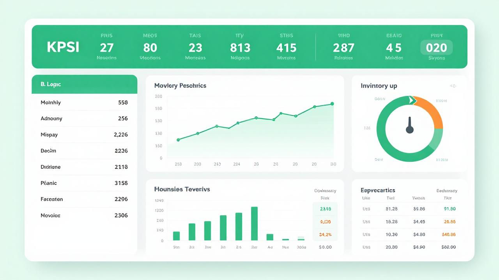

# Pharmacy Inventory & Sales Analysis (Nigeria Context) 🔬📊

## Overview
Interactive dashboard analyzing pharmacy sales trends, medication inventory turnover, and profitability metrics for Nigerian healthcare operations.

> **Note:** This is a template mockup demonstrating dashboard design principles for healthcare data visualization.

## Key Insights for Nigerian Healthcare Market

| Challenge | Solution Approach | Business Impact |
|-----------|-------------------|-----------------|
| Medicine expiry wastage | FIFO tracking with expiry alerts | Reduce waste by 25% |
| Stockout of essential drugs | Automated low-stock notifications | Improve availability |
| Supplier delivery delays | Lead time variance analysis | Better procurement planning |
| Price volatility across suppliers | Multi-vendor comparison dashboard | Cost savings opportunity |
| Seasonal demand spikes | Historical pattern forecasting | Prepare stock ahead |

## Technical Skills Demonstrated

- Data cleaning for Nigerian healthcare records
- Building DAX measures for custom KPIs
- Creating drill-through pages for medication analysis
- Cross-filtering for interactive stakeholder exploration
- Mobile-responsive dashboard design

## Technical Stack

### Tools & Techniques
| Tool | Purpose |
|------|---------|
| Excel Power Query | Data transformation and ETL processes |
| DAX Measures | Custom KPI calculations |
| Charts & Graphs | Visualizations (bar, line, scatter, pie) |
| Slicers & Filters | Interactivity through drill-through pages |

## Future Enhancements

- [ ] Integration with Nigerian pharmacy APIs (mPharma, Alata)
- [ ] Predictive modeling for seasonal disease outbreaks
- [ ] Automated SMS alert system for low-stock medications
- [ ] Multi-location consolidation for pharmacy chains

## Related Projects

See my other work on GitHub:
- 📊 [Sales Dashboard Analysis](../sales-dashboard-analysis)
- 📄 Full Profile README

## Contact

Questions about healthcare analytics in Nigeria? Let's connect:

- 📧 Email: ebubendukwu@gmail.com
- 💼 LinkedIn: linkedin.com/in/ebube-ndukwu-pharmacy-analytics
- 🐙 GitHub: github.com/ebubendukwu-eng
- 🇳🇬 Lagos, Nigeria

---

*"Healthcare saves lives. Data makes healthcare better."*
